# EventPortal — Enterprise Event Management & Media Showcase

A complete, production-ready web application for end-to-end event lifecycle management, ticket reservations, attendee check-ins, sponsorship tracking, financial analytics, and curated event media management.

---

## Table of Contents

1. [Overview & Key Capabilities](#overview--key-capabilities)
2. [15 Website Feature Screenshots & Detailed Explanations](#15-website-feature-screenshots--detailed-explanations)
3. [Technology Stack & Architecture](#technology-stack--architecture)
4. [Project Structure](#project-structure)
5. [Getting Started](#getting-started)

---

## Overview & Key Capabilities

EventPortal upgrades the original static HTML prototype (`ProjectDone.html`) into a modular React + TypeScript + Tailwind CSS application with persistent browser state (`localStorage`), real file-upload support, downloadable CSV/JSON exports, printable ticket receipts, and dark/light theme support.

- **15 Full-Featured Events**: Pre-seeded across 10 event formats (*Conference, Workshop, Meetup, Webinar, Gala, Hackathon, Forum, Bootcamp, Exhibition, Retreat*), complete with scheduled multi-session agendas, speaker profiles, capacities, and pricing.
- **Custom Image Upload & Media Studio**: Integrated media showcase with lightbox metadata inspection and local JPG/PNG/WEBP file uploads (`FileReader` persistence).
- **Complete End-to-End Workflows**: Accessible inline validation, confirmation modals, downloadable receipts, CSV/JSON reporting exports, and dark/light theme support.

---

## 15 Website Feature Screenshots & Detailed Explanations

Below are **15 live UI screenshots** captured directly from the running **EventPortal** application, illustrating each feature module and workflow in detail.

---

### 01. Dashboard Overview — KPIs, Operations Bar & Flagship Spotlight
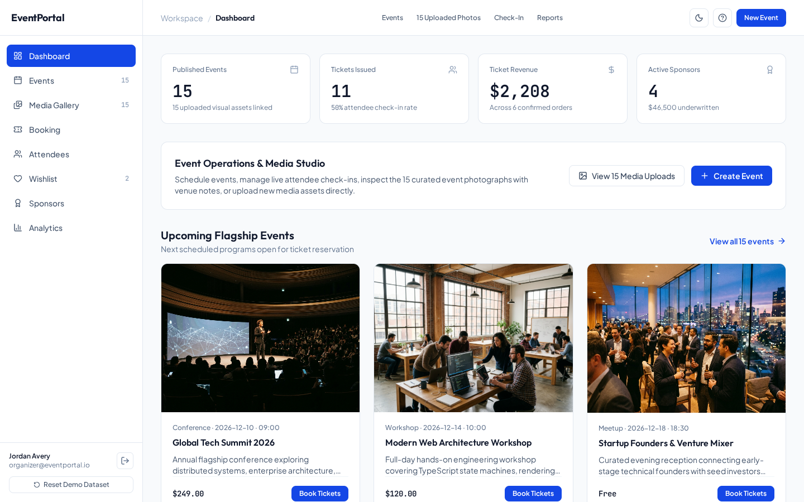

- **Screenshot**: `docs/screenshots/01-dashboard-overview.png`
- **Module**: `src/components/DashboardView.tsx`
- **Detailed Feature Explanation**: The primary command center presents four real-time tabular-numeral KPI cards (**Published Events**, **Tickets Issued & Check-In Rate**, **Ticket Revenue**, and **Active Sponsors**), an **Event Operations & Media Studio** quick-action strip, and the **Upcoming Flagship Events** 3-column spotlight with instant **Book Tickets** triggers.

---

### 02. Dashboard Overview — Recent Attendee Registrations Ledger
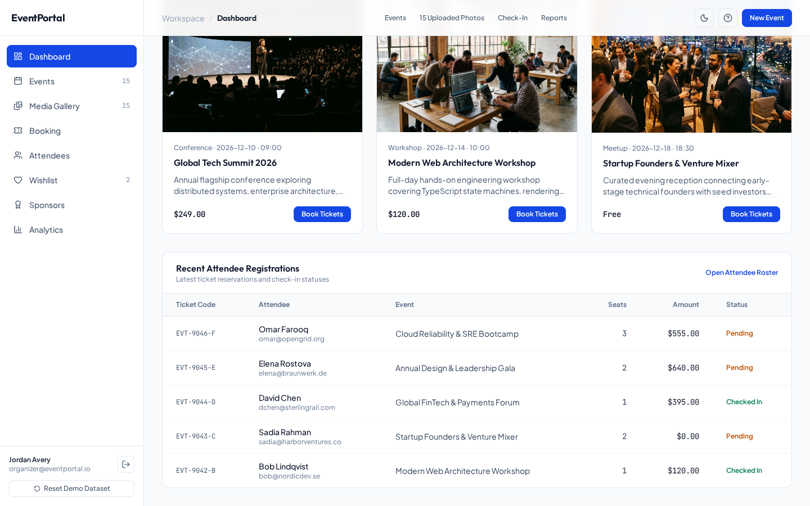

- **Screenshot**: `docs/screenshots/02-dashboard-recent-ledger.png`
- **Module**: `src/components/DashboardView.tsx`
- **Detailed Feature Explanation**: Located immediately below the event spotlight, this high-density table summarizes the latest ticket reservations with monospace ticket codes (`EVT-9046-F`), attendee emails, seat counts, exact payment totals, and explicit check-in status indicators (**Checked In** vs. **Pending**), plus a direct jump to the full Attendee Roster.

---

### 03. Events Directory — Multi-Criteria Search, Filter & Sort Grid
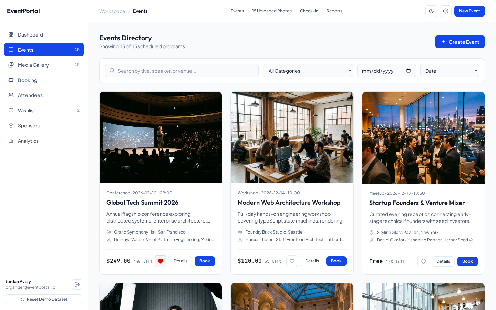

- **Screenshot**: `docs/screenshots/03-events-directory.png`
- **Module**: `src/components/EventsView.tsx`
- **Detailed Feature Explanation**: Displays all scheduled programs in a responsive 3-column grid featuring live keyword search (matching event titles, descriptions, speakers, or venues), category filtering, date filtering, and sorting by **Date** or **Price**. Each card displays remaining seat availability, a wishlist heart toggle, **Details**, and **Book** actions.

---

### 04. Event Detail Modal — Program Overview & Scheduled Agenda
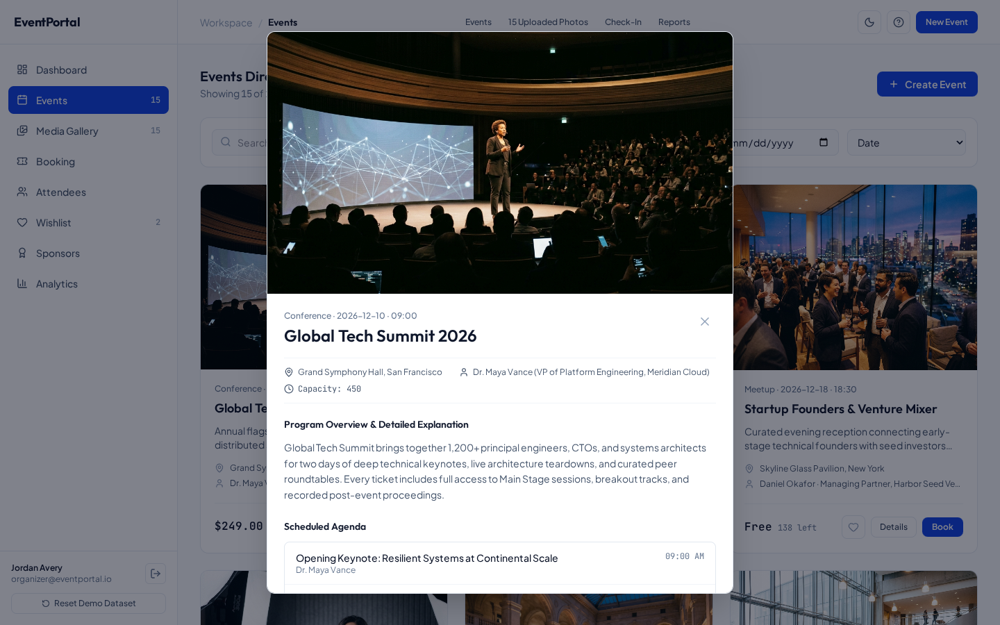

- **Screenshot**: `docs/screenshots/04-event-detail-agenda.png`
- **Module**: `src/components/EventsView.tsx`
- **Detailed Feature Explanation**: Clicking any event card opens the full **Event Detail Modal**, presenting the `16:9` cover preview, venue location, lead speaker credentials, capacity limits, full **Program Overview & Detailed Explanation**, a structured **Scheduled Agenda** timeline, and direct **Edit**, **Delete**, and **Reserve Tickets** controls.

---

### 05. Create & Edit Event Studio — Full Program & Image Picker Form
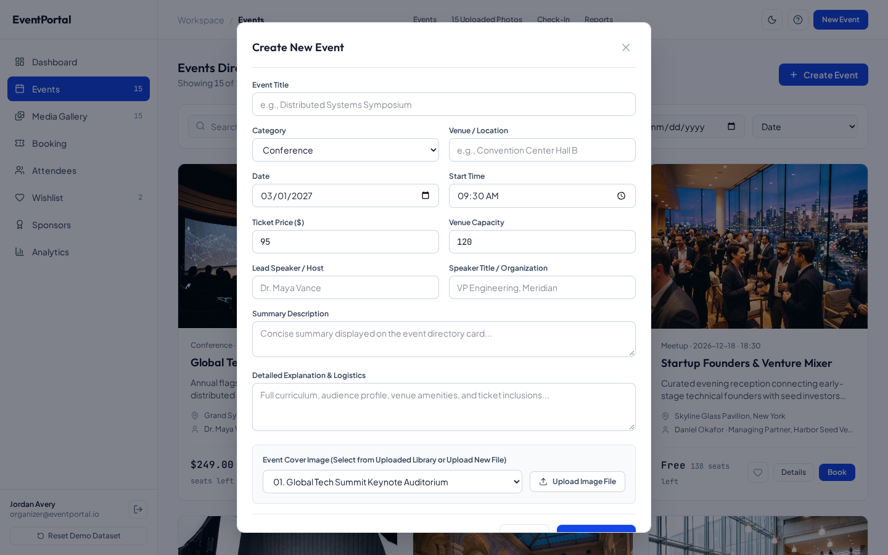

- **Screenshot**: `docs/screenshots/05-create-event-studio.png`
- **Module**: `src/components/EventsView.tsx`
- **Detailed Feature Explanation**: Organizers can create new events or edit existing ones with structured fields for title, category, venue, date, start time, ticket price, capacity, speaker bio, summary, and detailed logistics. The embedded **Event Cover Image** selector supports choosing from existing library assets or uploading a new image file from disk.

---

### 06. Media Gallery Showcase — Curated Library & Category Tabs
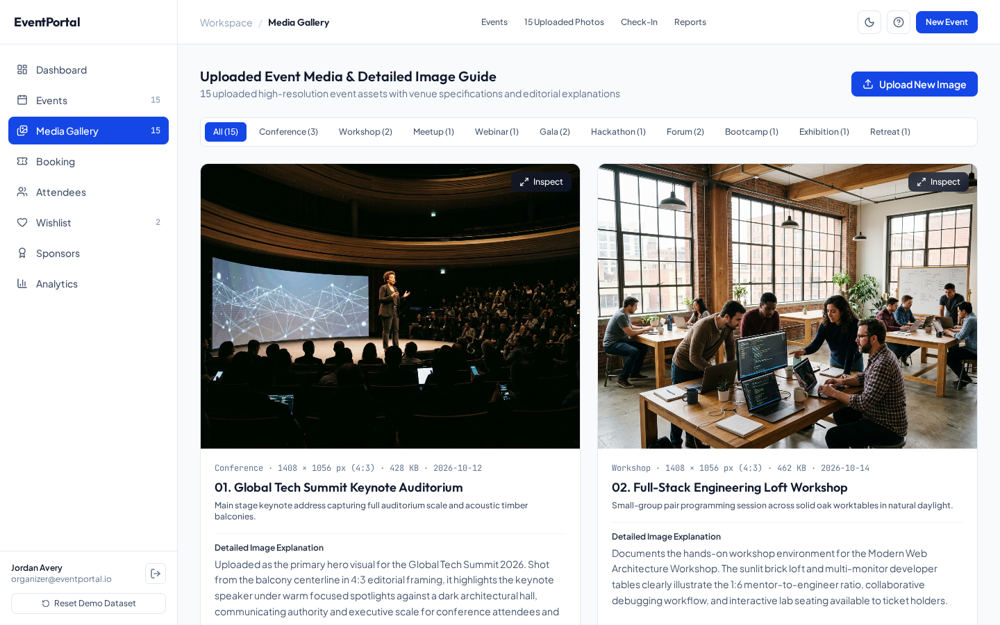

- **Screenshot**: `docs/screenshots/06-media-gallery-showcase.png`
- **Module**: `src/components/GalleryView.tsx`
- **Detailed Feature Explanation**: Dedicated media management workspace featuring category filter tabs, `4:3` visual cards with technical dimensions (`1408 × 1056 px`), file sizes, upload dates, venue tags, linked-event booking shortcuts, and detailed contextual explanations for every stored visual asset.

---

### 07. Media Upload Studio — Local File Dropzone & Metadata Form
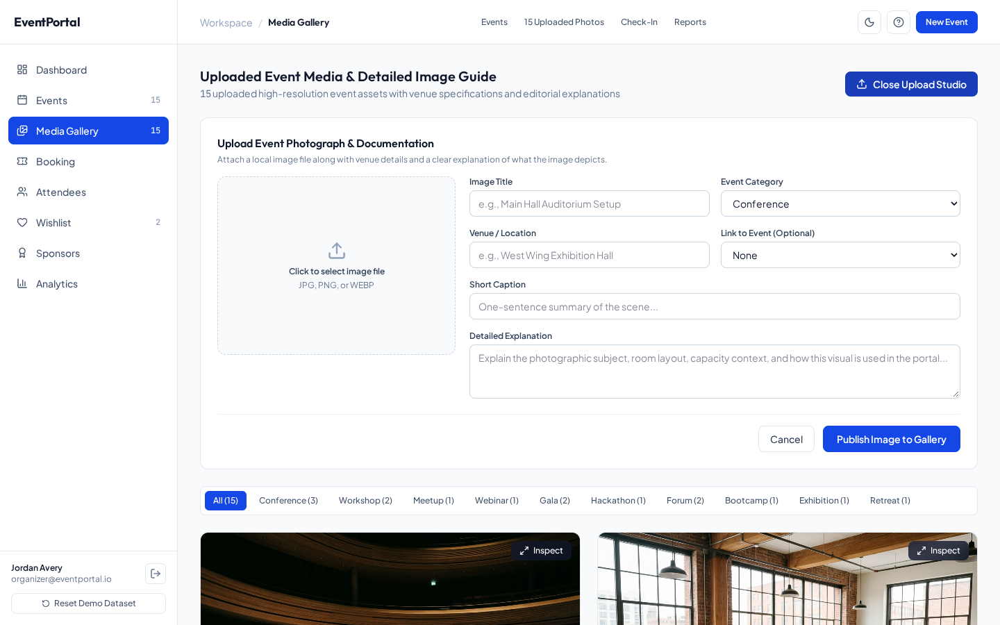

- **Screenshot**: `docs/screenshots/07-media-upload-studio.png`
- **Module**: `src/components/GalleryView.tsx`
- **Detailed Feature Explanation**: Clicking **Upload New Image** expands an interactive upload studio with a live preview dropzone accepting JPG, PNG, and WEBP files via the browser `FileReader` API. Organizers attach an image title, category, venue, linked event, short caption, and detailed explanation before publishing directly to the gallery.

---

### 08. Lightbox Metadata Inspector — Full-Resolution Asset Audit
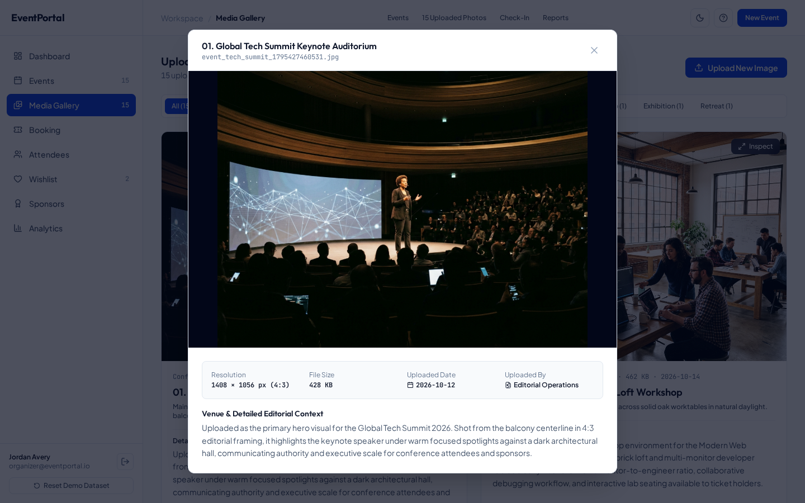

- **Screenshot**: `docs/screenshots/08-media-lightbox-inspector.png`
- **Module**: `src/components/GalleryView.tsx`
- **Detailed Feature Explanation**: Clicking **Inspect** on any media card opens a full-resolution lightbox dialog displaying the uncropped image alongside a 4-column metadata strip (**Resolution**, **File Size**, **Uploaded Date**, and **Uploaded By**) and complete venue/editorial documentation.

---

### 09. Ticket Booking & Checkout — Live Fee Calculation & Payment Methods
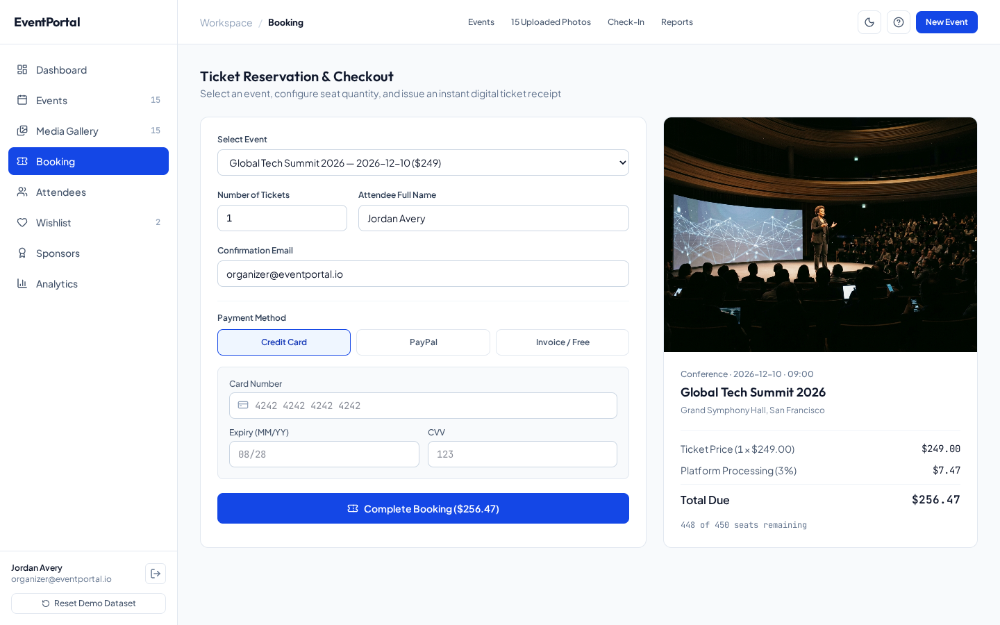

- **Screenshot**: `docs/screenshots/09-ticket-booking-checkout.png`
- **Module**: `src/components/BookingView.tsx`
- **Detailed Feature Explanation**: Two-column checkout workspace featuring an event selector, seat-quantity validation against remaining venue capacity, attendee details auto-filled from the signed-in profile, segmented payment tabs (**Credit Card** with automatic card number/expiry formatting, **PayPal**, and **Invoice / Free**), and a live order summary computing subtotal + 3% processing fee.

---

### 10. Confirmed Booking & Downloadable Digital Ticket Receipt
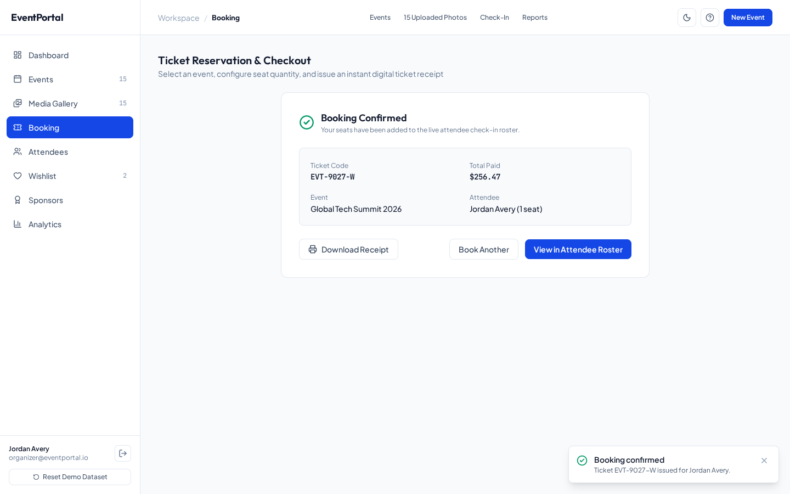

- **Screenshot**: `docs/screenshots/10-digital-ticket-receipt.png`
- **Module**: `src/components/BookingView.tsx`
- **Detailed Feature Explanation**: Completing checkout generates an instant confirmation screen with a unique alphanumeric ticket code (`EVT-9027-W`), total paid amount, attendee seat summary, toast confirmation, a **Download Receipt** button exporting a `.txt` ticket file, and automatic insertion into the live Attendee Roster.

---

### 11. Attendee Roster & Live Check-In Management
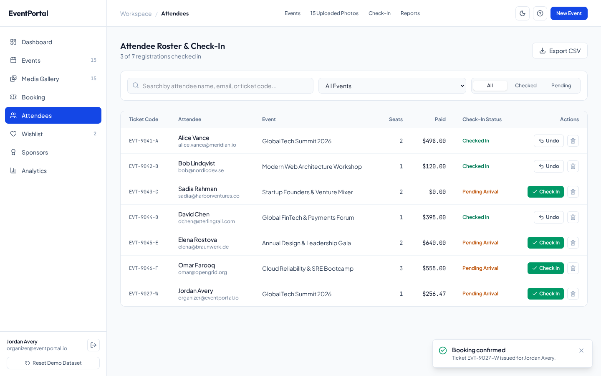

- **Screenshot**: `docs/screenshots/11-attendee-checkin-roster.png`
- **Module**: `src/components/AttendeesView.tsx`
- **Detailed Feature Explanation**: Operational check-in console supporting search by name, email, or ticket code, filtering by specific event, and segmented status tabs (**All**, **Checked**, **Pending**). Staff can toggle **Check In** / **Undo** in one click, safely remove entries via confirmation modal, or click **Export CSV** to download the filtered roster.

---

### 12. Saved Wishlist & Configurable Event Reminders
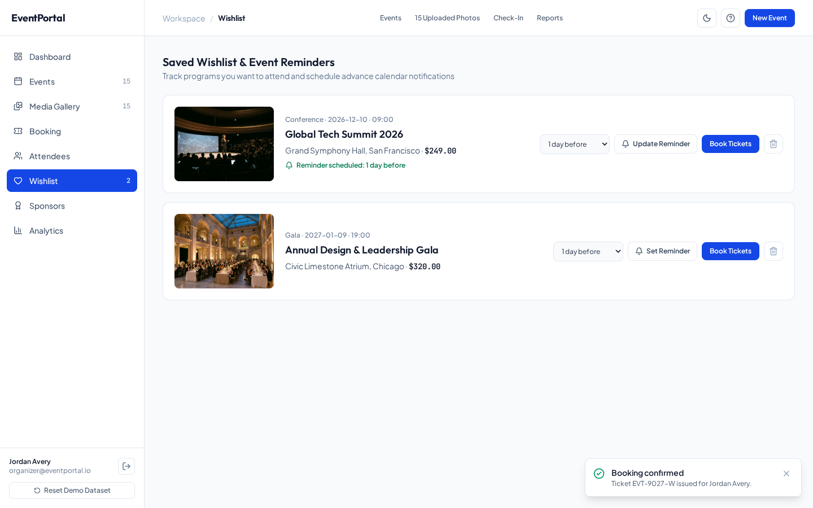

- **Screenshot**: `docs/screenshots/12-wishlist-reminders.png`
- **Module**: `src/components/WishlistView.tsx`
- **Detailed Feature Explanation**: Displays all bookmarked events with cover thumbnails, venue/date metadata, ticket pricing, configurable advance reminder intervals (`2 hours before`, `1 day before`, `3 days before`, `1 week before`), active scheduled reminder indicators, and one-click **Book Tickets** or removal controls.

---

### 13. Sponsors & Underwriting Tiers Directory
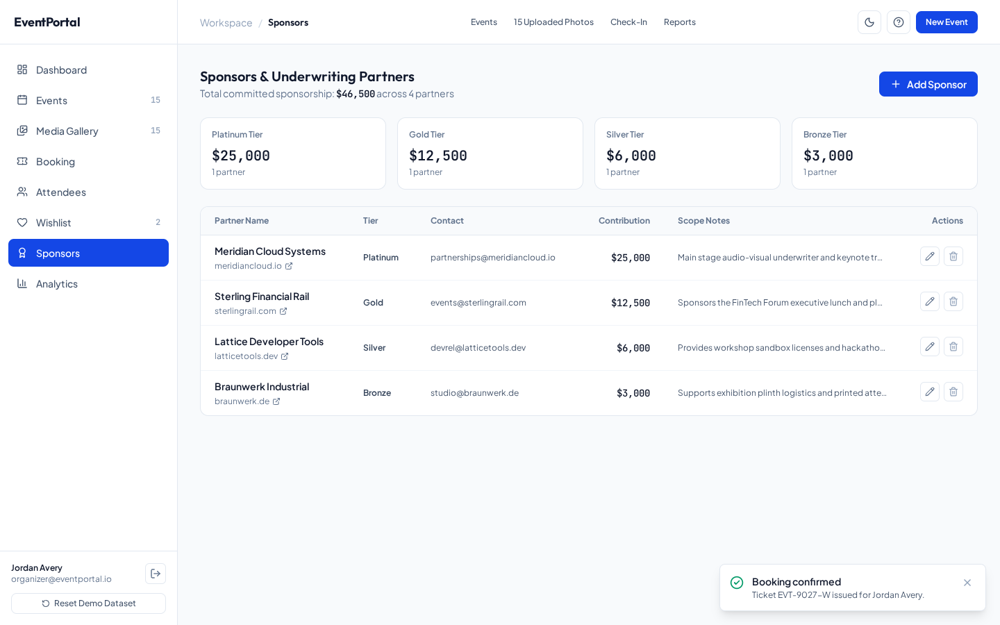

- **Screenshot**: `docs/screenshots/13-sponsors-directory.png`
- **Module**: `src/components/SponsorsView.tsx`
- **Detailed Feature Explanation**: Tracks total committed underwriting funds across **Platinum**, **Gold**, **Silver**, and **Bronze** tier summary cards alongside a structured partner ledger detailing organization websites, contact emails, dollar contributions, scope notes, and full Add / Edit / Remove modal workflows.

---

### 14. Analytics & Financial Reporting — Revenue Bars & Exports
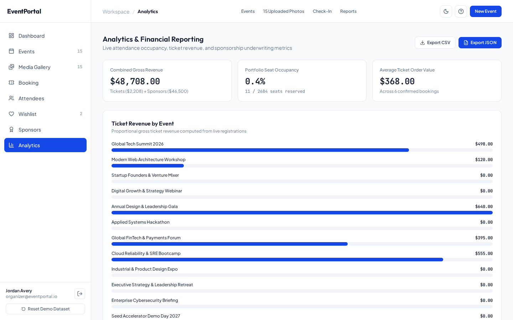

- **Screenshot**: `docs/screenshots/14-analytics-revenue-reports.png`
- **Module**: `src/components/AnalyticsView.tsx`
- **Detailed Feature Explanation**: Computes live portfolio metrics (**Combined Gross Revenue**, **Portfolio Seat Occupancy %**, and **Average Ticket Order Value**), renders proportional **Ticket Revenue by Event** horizontal bars, presents an event-by-event occupancy breakdown table, and provides one-click **Export CSV** and **Export JSON** report downloads.

---

### 15. Dark Mode Workspace & Slide-Over Portal Help Desk
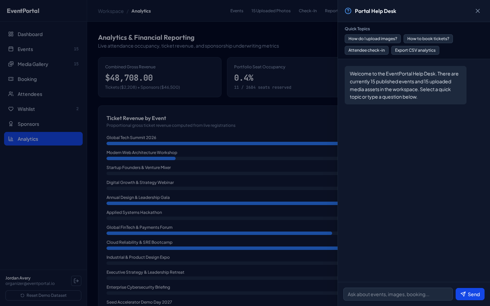

- **Screenshot**: `docs/screenshots/15-dark-mode-help-desk.png`
- **Module**: `src/App.tsx` & `src/components/HelpDrawer.tsx`
- **Detailed Feature Explanation**: Demonstrates the full **Dark Theme** (`@custom-variant dark` across all surfaces, cards, charts, and tables) paired with the slide-over **Portal Help Desk** drawer, offering quick-topic buttons and grounded navigation shortcuts across all portal modules.

---

## Technology Stack & Architecture

- **Frontend Framework**: React 18 with strict TypeScript (`tsconfig.json`)
- **Build & Dev Server**: Vite 6 (`host: 0.0.0.0`, `port: 3000`)
- **Styling**: Tailwind CSS v4 (`@tailwindcss/vite`, `@custom-variant dark`)
- **Typography**: `Outfit` (Display), `Plus Jakarta Sans` (UI/Body), `JetBrains Mono` (Tabular Numerals)
- **Icons**: `lucide-react`
- **State Persistence**: Browser `localStorage` with one-click **Reset Demo Dataset** restoration

---

## Project Structure

```text
├── index.html                  # HTML entry with Google Fonts & SEO meta tags
├── metadata.json               # Applet metadata
├── package.json                # Dependencies and Vite scripts
├── vite.config.ts              # Vite + Tailwind v4 config (port 3000)
├── tsconfig.json               # Strict TypeScript configuration
├── README.md                   # Complete documentation & 15 website feature screenshots
├── docs/
│   └── screenshots/            # 15 captured UI feature screenshots (.png)
└── src/
    ├── main.tsx                # React root mount
    ├── index.css               # Tailwind v4 setup & typography rules
    ├── types.ts                # Domain interfaces (Events, MediaAsset, Attendee, Sponsor)
    ├── App.tsx                 # Main workspace shell, state, persistence, routing
    ├── assets/images/          # Seeded event photography (.jpg)
    ├── data/
    │   └── seedData.ts         # Events, media records, attendees, sponsors, reminders
    └── components/
        ├── AnalyticsView.tsx   # Revenue bars, occupancy table, CSV/JSON export
        ├── AttendeesView.tsx   # Roster table, live check-in, CSV export
        ├── AuthModal.tsx       # Sign-in, registration, demo organizer login
        ├── BookingView.tsx     # Checkout calculator & downloadable ticket receipts
        ├── ConfirmModal.tsx    # Accessible confirmation dialog
        ├── DashboardView.tsx   # KPI strip, operations bar, spotlight, recent ledger
        ├── EventsView.tsx      # Searchable grid, agenda modal, create/edit with upload
        ├── GalleryView.tsx     # Media gallery showcase, lightbox inspector, upload studio
        ├── HelpDrawer.tsx      # Interactive support & navigation desk
        ├── ResilientImage.tsx  # Zero-broken-image wrapper with styled fallback
        ├── SponsorsView.tsx    # Sponsor tiers & CRUD ledger
        ├── ToastContainer.tsx  # In-app notification stack
        └── WishlistView.tsx    # Saved events & configurable reminders
```

---

## Getting Started

```bash
# 1. Install dependencies
npm install

# 2. Start the development server on port 3000
npm run dev

# 3. Type-check and build for production
npm run build
```
