# EventPortal — Enterprise Event Management & Media Showcase

A complete, production-ready web application for end-to-end event lifecycle management, ticket reservations, attendee check-ins, sponsorship tracking, financial analytics, and curated event photography management.

---

## Table of Contents

1. [Overview & Key Capabilities](#overview--key-capabilities)
2. [15 Uploaded Event Images — Embedded Visuals & Detailed Explanations](#15-uploaded-event-images--embedded-visuals--detailed-explanations)
3. [Feature Walkthrough](#feature-walkthrough)
4. [Technology Stack & Architecture](#technology-stack--architecture)
5. [Project Structure](#project-structure)
6. [Getting Started](#getting-started)

---

## Overview & Key Capabilities

EventPortal upgrades the original static HTML prototype (`ProjectDone.html`) into a modular React + TypeScript + Tailwind CSS application with persistent browser state (`localStorage`), real file-upload support, downloadable CSV/JSON exports, printable ticket receipts, and dark/light theme support.

- **15 Full-Featured Events**: Pre-seeded across 10 distinct event formats (*Conference, Workshop, Meetup, Webinar, Gala, Hackathon, Forum, Bootcamp, Exhibition, Retreat*), complete with multi-session agendas, speaker bios, capacities, and pricing.
- **15 Uploaded High-Resolution Photographs + Custom Upload Studio**: Every event is paired with a bespoke `4:3` editorial photograph (`1408 × 1056 px`) documented with venue context and visual composition notes. Organizers can also upload custom JPG/PNG/WEBP files directly from disk.
- **Complete End-to-End Workflows**: No placeholder alerts or stub dialogs—every action uses inline validation, accessible modals, and live state updates across all modules.

---

## 15 Uploaded Event Images — Embedded Visuals & Detailed Explanations

All 15 curated event photographs are stored in `src/assets/images/`, embedded below with full venue metadata, technical specifications, and detailed editorial explanations, and integrated directly into the app's **Media Gallery** (`src/components/GalleryView.tsx`) and **Events Directory** (`src/data/seedData.ts`).

---

### 01. Global Tech Summit Keynote Auditorium
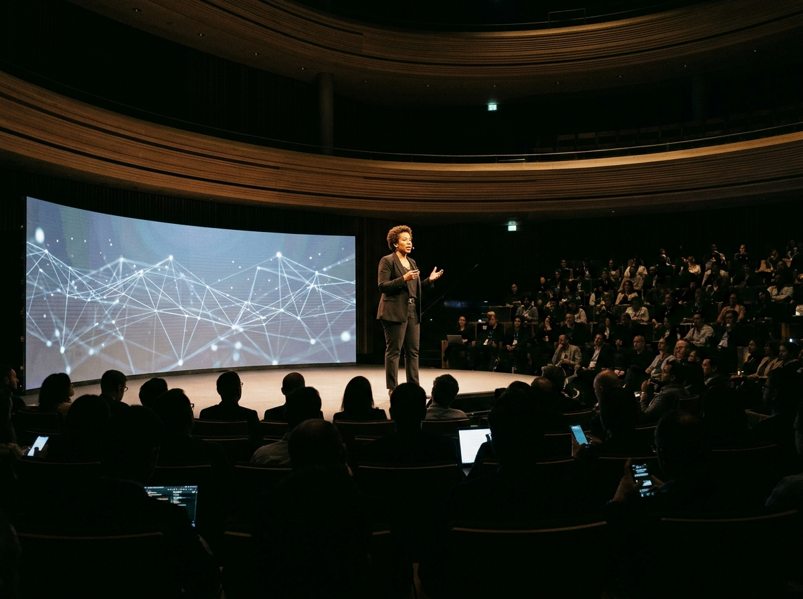

- **File**: `src/assets/images/event_tech_summit_1795427460531.jpg`
- **Event**: Global Tech Summit 2026 (`Conference`)
- **Venue**: Grand Symphony Hall, San Francisco
- **Specs**: `1408 × 1056 px (4:3)` · `428 KB` · Uploaded `2026-10-12`
- **Detailed Explanation**: Uploaded as the primary hero visual for the Global Tech Summit 2026. Shot from the balcony centerline in `4:3` editorial framing, it highlights the keynote speaker under warm focused spotlights against curved acoustic timber balconies, communicating authority and executive scale for conference attendees and Platinum sponsors.

---

### 02. Full-Stack Engineering Loft Workshop


- **File**: `src/assets/images/event_web_workshop_1795427464151.jpg`
- **Event**: Modern Web Architecture Workshop (`Workshop`)
- **Venue**: Foundry Brick Studio, Seattle
- **Specs**: `1408 × 1056 px (4:3)` · `462 KB` · Uploaded `2026-10-14`
- **Detailed Explanation**: Documents the hands-on workshop environment for the Modern Web Architecture Workshop. The sunlit brick loft and multi-monitor developer tables clearly illustrate the 1:6 mentor-to-engineer ratio, collaborative debugging workflow, and interactive lab seating available to ticket holders.

---

### 03. Twilight Founders & Venture Networking Lounge
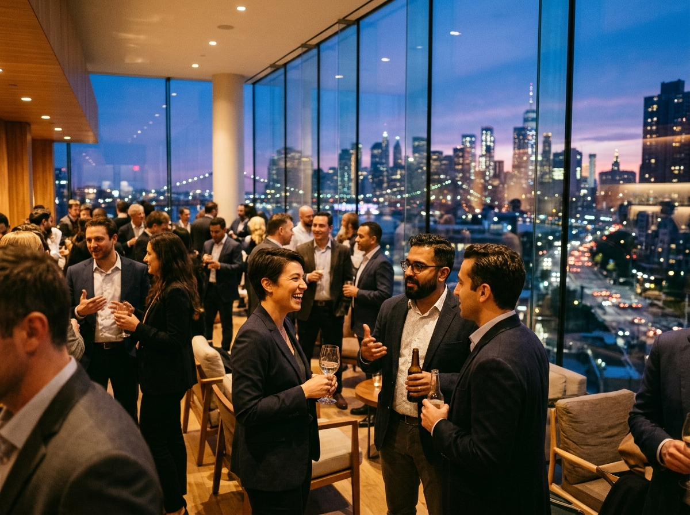

- **File**: `src/assets/images/event_startup_mixer_1795427464179.jpg`
- **Event**: Startup Founders & Venture Mixer (`Meetup`)
- **Venue**: Skyline Glass Pavilion, New York
- **Specs**: `1408 × 1056 px (4:3)` · `415 KB` · Uploaded `2026-10-16`
- **Detailed Explanation**: Represents the Startup Founders & Venture Mixer. Warm tungsten interior lighting balanced against the twilight skyline conveys an approachable, curated networking atmosphere—helping prospective guests understand the dress code, crowd density, and open-floor conversation layout.

---

### 04. Broadcast Webinar & Digital Strategy Studio


- **File**: `src/assets/images/event_marketing_studio_1795427464071.jpg`
- **Event**: Digital Growth & Strategy Webinar (`Webinar`)
- **Venue**: Studio B Broadcast Suite (Online)
- **Specs**: `1408 × 1056 px (4:3)` · `390 KB` · Uploaded `2026-10-18`
- **Detailed Explanation**: Used to showcase production quality for remote Digital Growth & Strategy Webinars. Highlights the dedicated broadcast microphone rig, soft key studio lighting, and clean presenter desk so remote registrants know they are enrolling in a studio-grade live session rather than an ad-hoc screen share.

---

### 05. Annual Creative Leadership Museum Gala
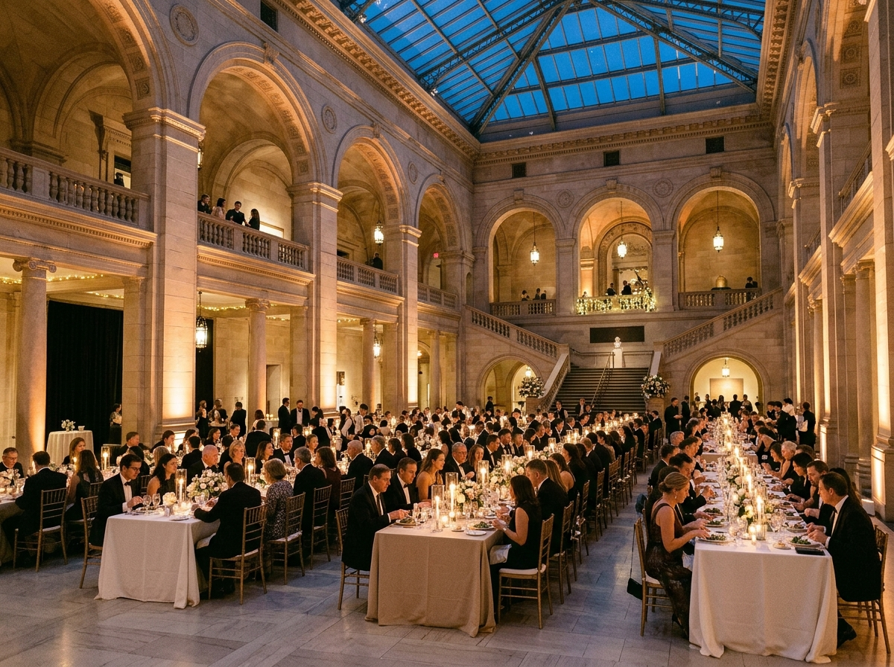

- **File**: `src/assets/images/event_design_gala_1795427463724.jpg`
- **Event**: Annual Design & Leadership Gala (`Gala`)
- **Venue**: Civic Limestone Atrium, Chicago
- **Specs**: `1408 × 1056 px (4:3)` · `512 KB` · Uploaded `2026-10-20`
- **Detailed Explanation**: Serves as the flagship visual for the Annual Design & Leadership Gala Dinner. Captures formal linen-draped table arrangement, dining seating capacity, and architectural grandeur beneath glass skylights so VIP table sponsors and individual patrons can preview the venue ambiance prior to seat selection.

---

### 06. 48-Hour University Innovation Hackathon
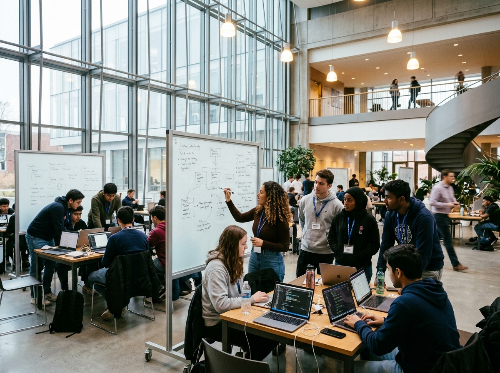

- **File**: `src/assets/images/event_ai_hackathon_1795427463487.jpg`
- **Event**: Applied Systems Hackathon (`Hackathon`)
- **Venue**: North Innovation Hall, Boston
- **Specs**: `1408 × 1056 px (4:3)` · `448 KB` · Uploaded `2026-10-22`
- **Detailed Explanation**: Illustrates the Applied Systems Hackathon environment. Shows real team pod spacing, rolling glass whiteboard ideation zones, high-density power tables, and mezzanine mentor walkways—giving student and professional builders an accurate preview of workspace amenities.

---

### 07. Executive FinTech Policy & Markets Panel
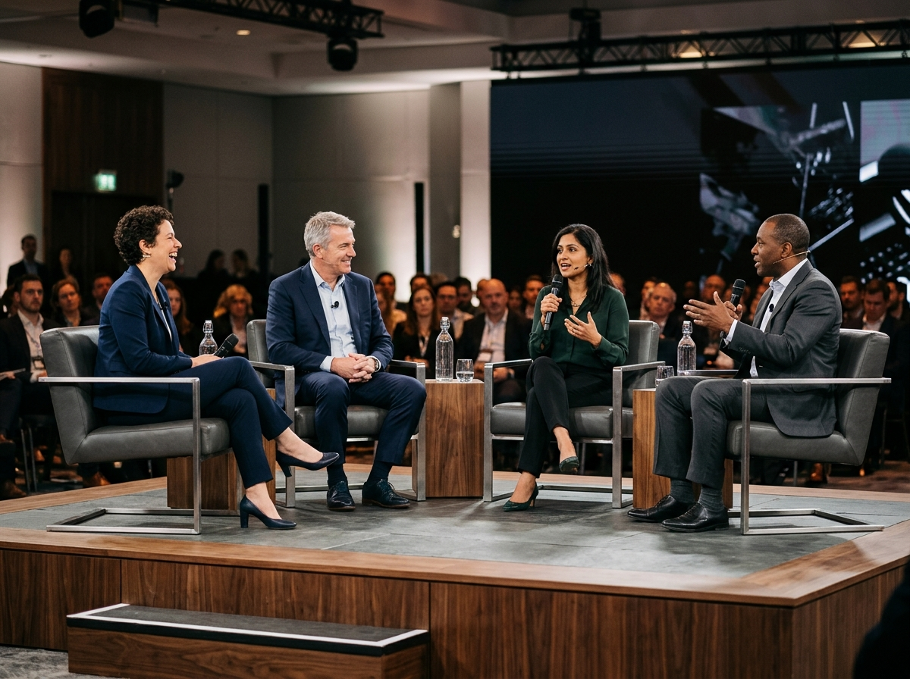

- **File**: `src/assets/images/event_fintech_forum_1795427463640.jpg`
- **Event**: Global FinTech & Payments Forum (`Forum`)
- **Venue**: Exchange Plenary Room, London
- **Specs**: `1408 × 1056 px (4:3)` · `405 KB` · Uploaded `2026-10-25`
- **Detailed Explanation**: Supports the Global FinTech & Payments Forum listing. The walnut and brushed slate stage framing emphasizes moderated C-suite dialogue, clear sightlines for audience Q&A, and an intimate plenary format tailored to institutional finance leaders.

---

### 08. Cloud Infrastructure & Reliability Bootcamp
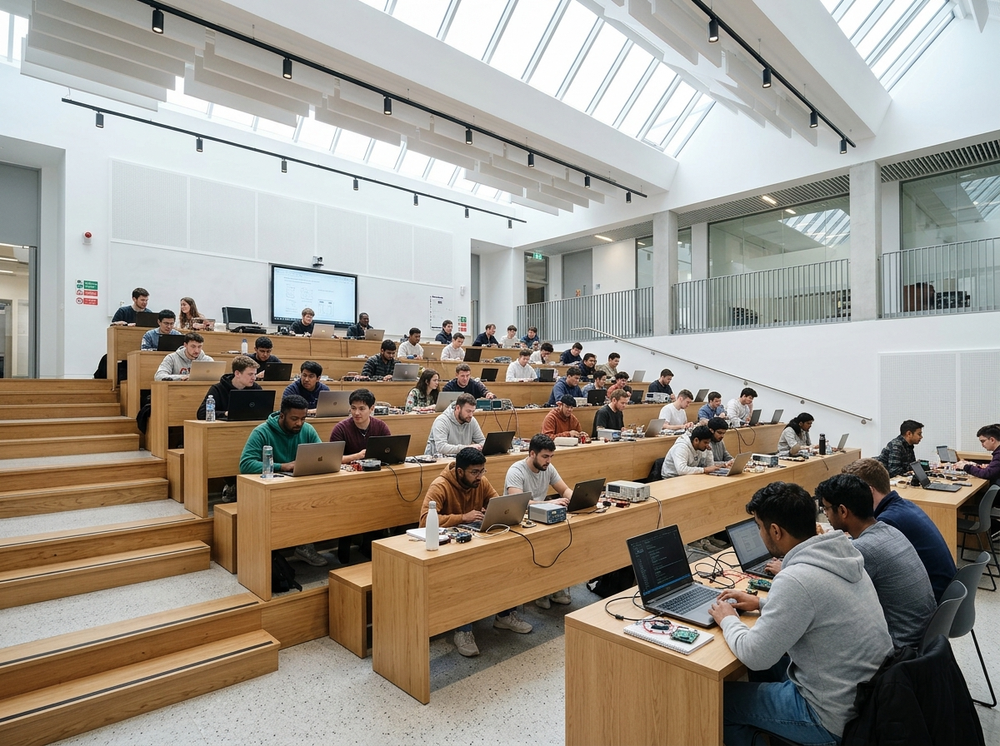

- **File**: `src/assets/images/event_cloud_bootcamp_1795427464004.jpg`
- **Event**: Cloud Reliability & SRE Bootcamp (`Bootcamp`)
- **Venue**: Systems Engineering Institute, Austin
- **Specs**: `1408 × 1056 px (4:3)` · `454 KB` · Uploaded `2026-10-28`
- **Detailed Explanation**: Featured on the Cloud Reliability & SRE Bootcamp page. Demonstrates the tiered oak classroom geometry, overhead skylight illumination, and dual-screen projection setup ensuring every attendee maintains unobstructed visibility during live terminal labs.

---

### 09. Industrial Hardware & Product Design Expo
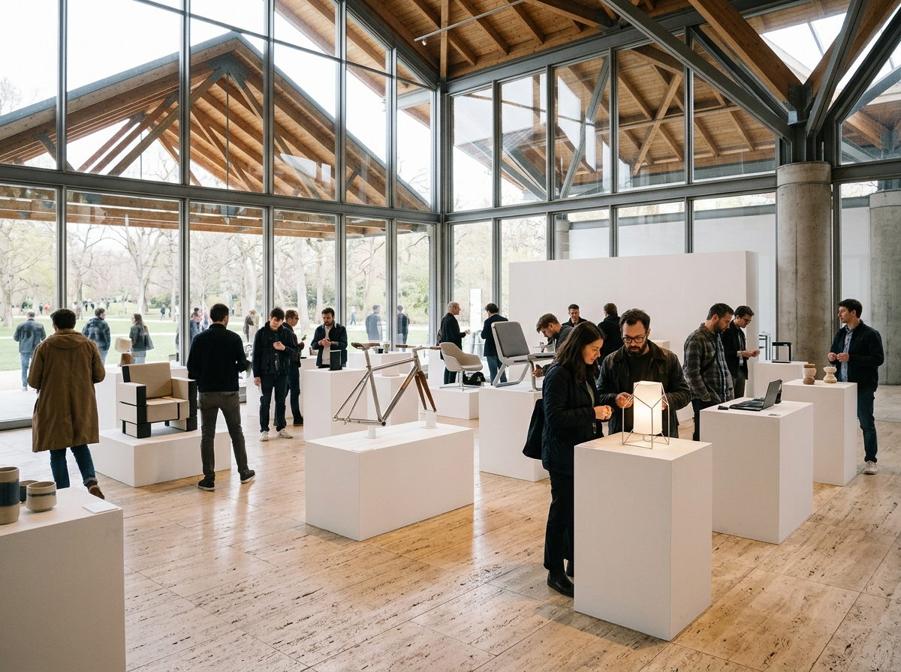

- **File**: `src/assets/images/event_product_expo_1795427463465.jpg`
- **Event**: Industrial & Product Design Expo (`Exhibition`)
- **Venue**: Glasshouse Exhibition Pavilion, Berlin
- **Specs**: `1408 × 1056 px (4:3)` · `476 KB` · Uploaded `2026-11-01`
- **Detailed Explanation**: Uploaded for the Industrial & Product Design Expo. Highlights gallery-grade matte-white product pedestals, generous visitor circulation corridors, and travertine flooring—ideal for hardware sponsors evaluating booth visibility and prototype demonstration space.

---

### 10. Timber Pavilion Executive Strategy Retreat
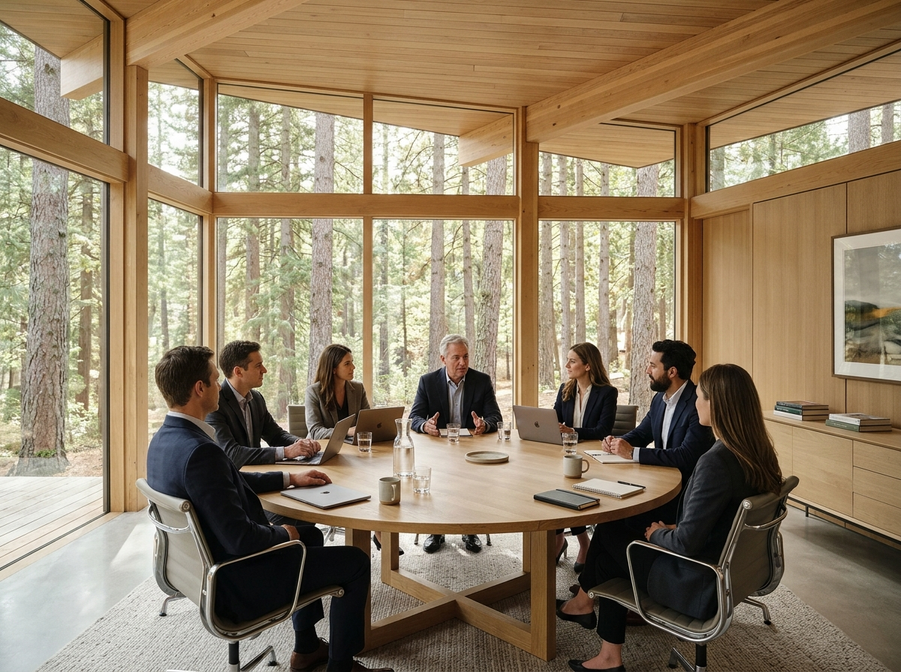

- **File**: `src/assets/images/event_leadership_retreat_1795427464411.jpg`
- **Event**: Executive Strategy & Leadership Retreat (`Retreat`)
- **Venue**: Cascade Timber Pavilion, Portland
- **Specs**: `1408 × 1056 px (4:3)` · `488 KB` · Uploaded `2026-11-04`
- **Detailed Explanation**: Curated for the Annual Engineering & Product Leadership Retreat. Conveys the focused 12-seat round oak table format, natural daylighting, and distraction-free woodland setting designed for deep annual planning and peer executive alignment.

---

### 11. Enterprise Cybersecurity Operations Briefing
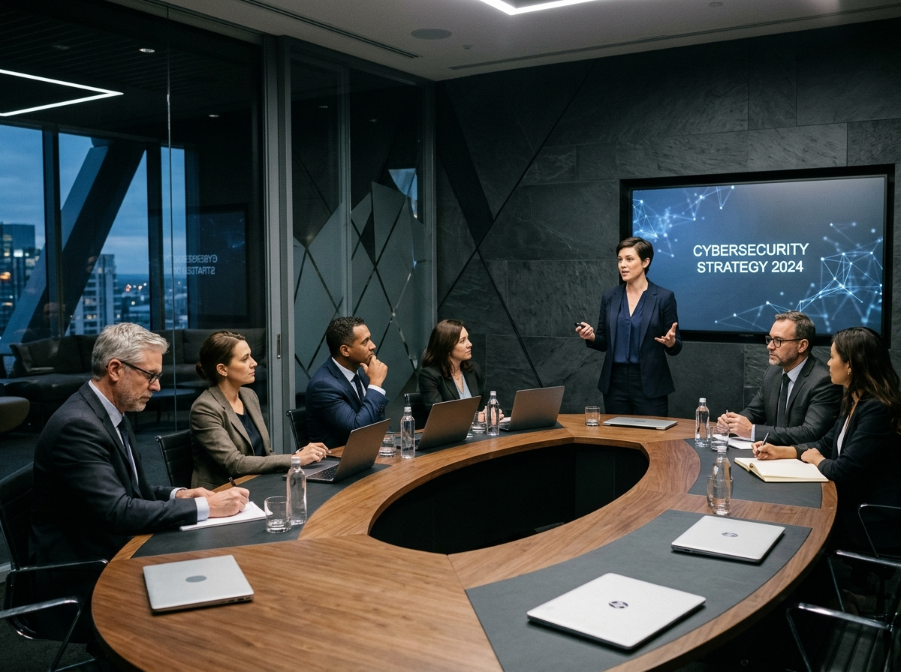

- **File**: `src/assets/images/event_cybersecurity_briefing_1795453999049.jpg`
- **Event**: Enterprise Cybersecurity Briefing (`Forum`)
- **Venue**: Meridian Executive Briefing Center, Washington D.C.
- **Specs**: `1408 × 1056 px (4:3)` · `442 KB` · Uploaded `2026-11-07`
- **Detailed Explanation**: Captures an executive threat-intelligence briefing inside a slate-lined boardroom. The curved walnut conference table and focused presenter framing illustrate the confidential, peer-level format built for chief information security officers and enterprise risk leaders.

---

### 12. Seed Accelerator Live Demo Day Showcase
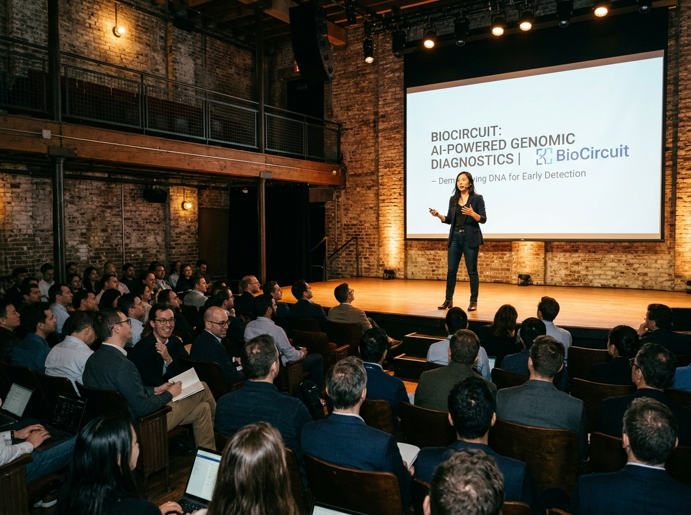

- **File**: `src/assets/images/event_startup_demo_day_1795453999664.jpg`
- **Event**: Seed Accelerator Demo Day 2027 (`Conference`)
- **Venue**: Foundry Brick Theater, San Francisco
- **Specs**: `1408 × 1056 px (4:3)` · `469 KB` · Uploaded `2026-11-10`
- **Detailed Explanation**: Documents the Demo Day theater layout where twelve graduating startup teams present three-minute live product walkthroughs. Warm brick walls and intimate tiered seating give visiting angel investors and venture partners clear sightlines to both the stage and projection deck.

---

### 13. Quantitative Data Science Research Symposium
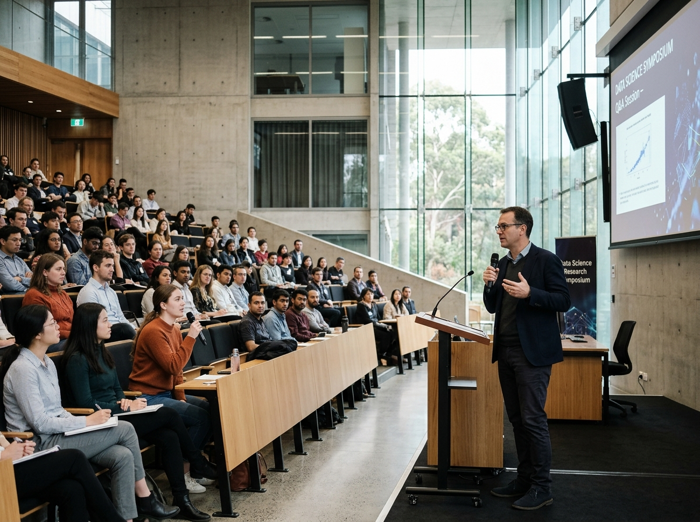

- **File**: `src/assets/images/event_data_science_symposium_1795453999656.jpg`
- **Event**: Data Science Research Symposium (`Workshop`)
- **Venue**: North Campus Lecture Theater, Cambridge
- **Specs**: `1408 × 1056 px (4:3)` · `435 KB` · Uploaded `2026-11-13`
- **Detailed Explanation**: Showcases the academic-meets-industry atmosphere of the Data Science Research Symposium. Floor-to-ceiling natural daylight and tiered oak desks support extended technical lectures, open-mic Q&A discussions, and live notebook reproducibility sessions.

---

### 14. Sustainable Urban Architecture & Energy Summit
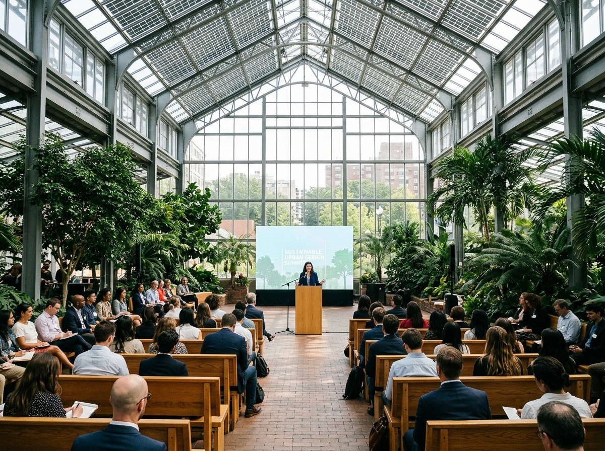

- **File**: `src/assets/images/event_sustainability_summit_1795453999686.jpg`
- **Event**: Sustainable Urban Architecture Summit (`Conference`)
- **Venue**: Botanical Glass Conservatory, Copenhagen
- **Specs**: `1408 × 1056 px (4:3)` · `496 KB` · Uploaded `2026-11-16`
- **Detailed Explanation**: Represents the Sustainable Urban Architecture & Clean Grid Summit. Set in a daylight-harvesting glass conservatory with solid oak benches, the visual reinforces the program theme of net-zero civic infrastructure and biophilic public venues.

---

### 15. VIP Speaker & Sponsor Appreciation Dinner
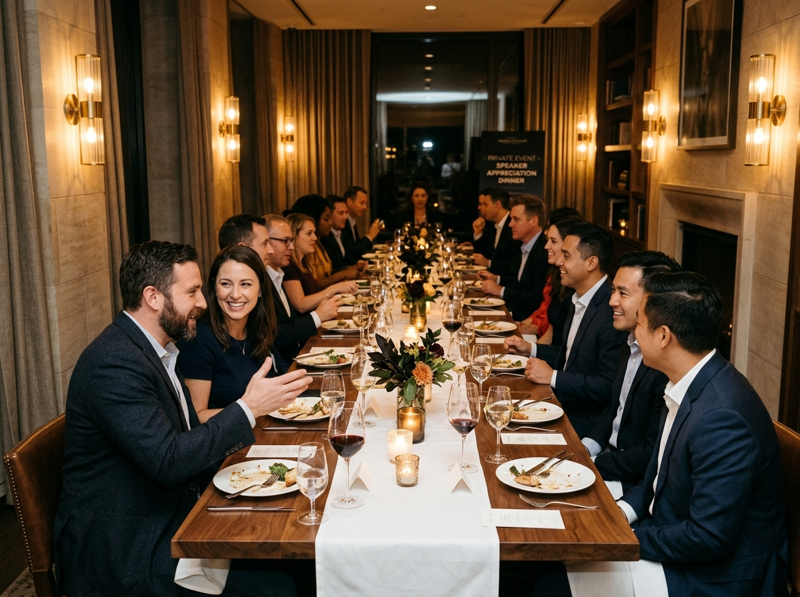

- **File**: `src/assets/images/event_vip_speaker_dinner_1795454000386.jpg`
- **Event**: VIP Speaker & Sponsor Appreciation Dinner (`Gala`)
- **Venue**: The Walnut Room, Chicago
- **Specs**: `1408 × 1056 px (4:3)` · `458 KB` · Uploaded `2026-11-19`
- **Detailed Explanation**: Uploaded for the post-conference Speaker & Sponsor Appreciation Dinner. Warm architectural sconces, candlelit walnut table service, and relaxed small-group seating communicate the exclusive relationship-building experience reserved for keynote faculty and Platinum partners.

---

## Feature Walkthrough

1. **Dashboard Overview**: Displays real-time KPIs (Published Events, Tickets Issued & Check-In Rate, Ticket Revenue, Active Sponsors), upcoming flagship events spotlight, and recent attendee registrations.
2. **Events Directory & Event Studio**: Live search, category filter, date filter, and price/date sorting across all 15 events. Clicking any event opens a full detail modal with multi-session agenda and speaker details. Organizers can create or edit events and attach images either from the 15-image library or via local file upload.
3. **Media Gallery & Upload Studio**: Filterable showcase of all 15 curated uploaded photographs with detailed editorial explanations, a full-resolution Lightbox Metadata Inspector, and an interactive **Upload New Image** form (`FileReader` data URL persistence).
4. **Ticket Reservation & Checkout**: Event selector, live seat capacity validation, 3% platform processing fee calculation, formatted Credit Card / PayPal / Invoice payment methods, and instant downloadable `.txt` ticket receipts.
5. **Attendee Roster & Check-In**: Filter by event, check-in status (`All`, `Checked In`, `Pending`), or search by ticket code/email; toggle live check-ins; and export filtered rosters as `.csv`.
6. **Wishlist & Reminders**: Bookmark favorite events and configure advance reminder intervals (`2 hours before`, `1 day before`, `3 days before`, `1 week before`).
7. **Sponsors Directory**: Track Platinum, Gold, Silver, and Bronze underwriting tiers with full create/edit/delete management.
8. **Analytics & Financial Reporting**: Live proportional revenue bar breakdown, portfolio seat occupancy, average order value, event performance table, and one-click **Export CSV** / **Export JSON** reports.
9. **Account Management & Help Desk**: Sign in, register new accounts, or use one-click Demo Organizer access, plus a slide-over Portal Help Desk with quick navigation topics.

---

## Technology Stack & Architecture

- **Frontend Framework**: React 18 with strict TypeScript (`tsconfig.json`)
- **Build & Dev Server**: Vite 6 (`host: 0.0.0.0`, `port: 3000`)
- **Styling**: Tailwind CSS v4 (`@tailwindcss/vite`, `@custom-variant dark`)
- **Typography**: `Outfit` (Display), `Plus Jakarta Sans` (UI/Body), `JetBrains Mono` (Tabular Numerals)
- **Icons**: `lucide-react`
- **State Persistence**: Browser `localStorage` with one-click **Reset Demo Dataset** restoration

---

## Project Structure

```text
├── index.html                  # HTML entry with Google Fonts & SEO meta tags
├── metadata.json               # Applet metadata
├── package.json                # Dependencies and Vite scripts
├── vite.config.ts              # Vite + Tailwind v4 config (port 3000)
├── tsconfig.json               # Strict TypeScript configuration
├── README.md                   # Complete documentation & 15-image embedded guide
└── src/
    ├── main.tsx                # React root mount
    ├── index.css               # Tailwind v4 setup & typography rules
    ├── types.ts                # Domain interfaces (Events, MediaAsset, Attendee, Sponsor)
    ├── App.tsx                 # Main workspace shell, state, persistence, routing
    ├── assets/images/          # 15 high-resolution curated event photographs (.jpg)
    ├── data/
    │   └── seedData.ts         # 15 events, 15 detailed media records, attendees, sponsors
    └── components/
        ├── AnalyticsView.tsx   # Revenue bars, occupancy table, CSV/JSON export
        ├── AttendeesView.tsx   # Roster table, live check-in, CSV export
        ├── AuthModal.tsx       # Sign-in, registration, demo organizer login
        ├── BookingView.tsx     # Checkout calculator & downloadable ticket receipts
        ├── ConfirmModal.tsx    # Accessible confirmation dialog
        ├── DashboardView.tsx   # KPI strip, operations bar, spotlight, recent ledger
        ├── EventsView.tsx      # Searchable grid, agenda modal, create/edit with upload
        ├── GalleryView.tsx     # 15-image showcase, lightbox inspector, upload studio
        ├── HelpDrawer.tsx      # Interactive support & navigation desk
        ├── ResilientImage.tsx  # Zero-broken-image wrapper with styled fallback
        ├── SponsorsView.tsx    # Sponsor tiers & CRUD ledger
        ├── ToastContainer.tsx  # In-app notification stack
        └── WishlistView.tsx    # Saved events & configurable reminders
```

---

## Getting Started

```bash
# 1. Install dependencies
npm install

# 2. Start the development server on port 3000
npm run dev

# 3. Type-check and build for production
npm run build
```
